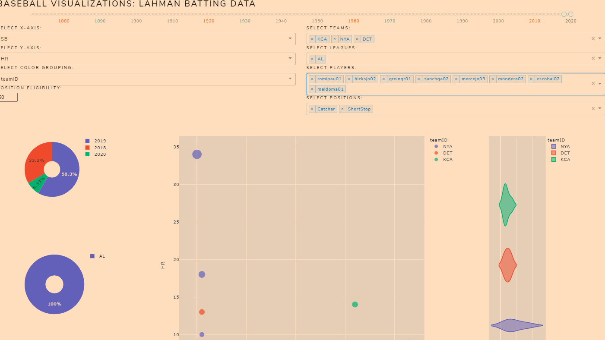
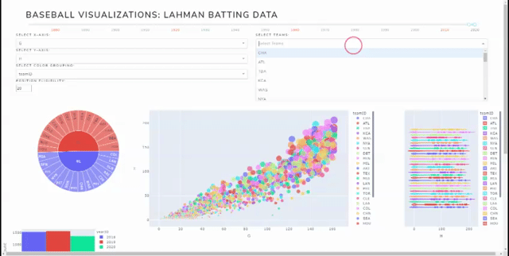
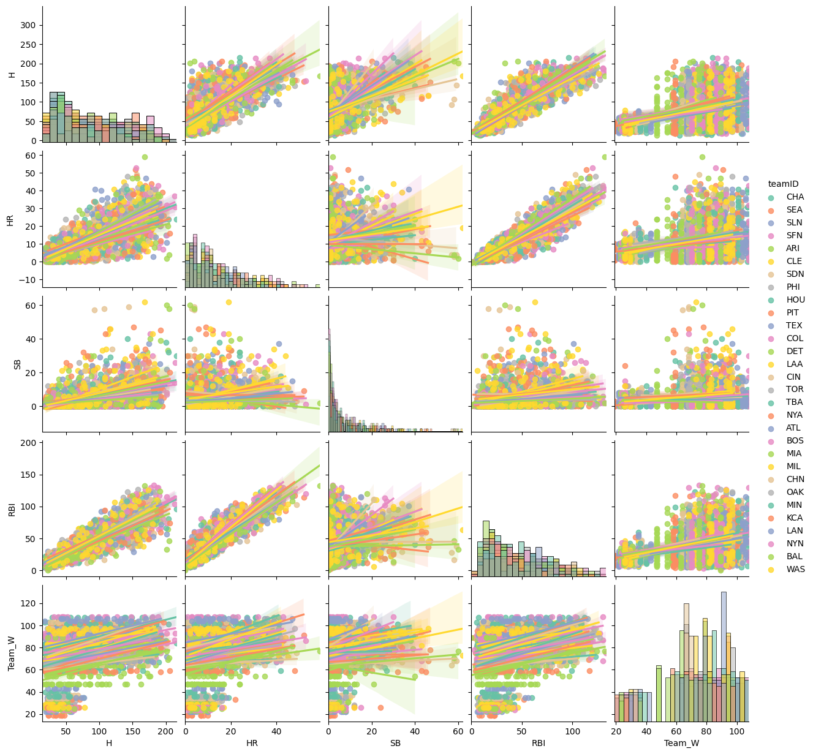
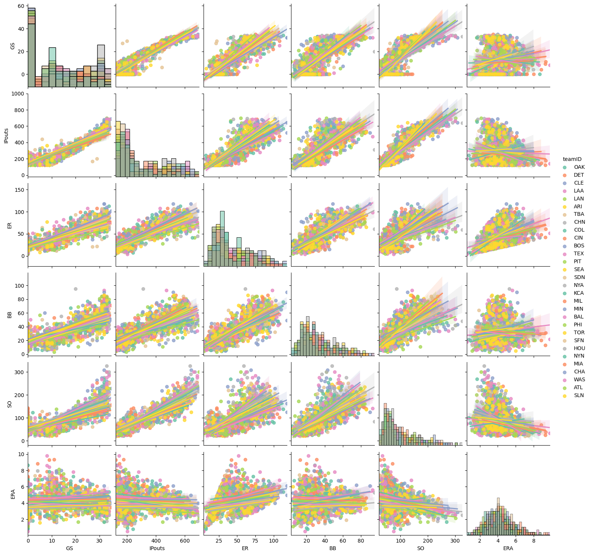

# Lahman-Dashboard
Creating a visual interactive dashboard for the Lahman Historical baseball Database

Lahman Database can be accessed at the following location:

http://www.seanlahman.com/baseball-archive/statistics/

Each of the following Dashboard utilize User's Input to narrow the range of included individuals and historical data.

This can be done by Years, Teams, Leagues, Players, Positions, or any combination the user seeks.

To adjust the graph output the user has the ability to select bothte  x-axis and y-axis values as well as the color grouping of the represented scatter and violin plots.

# Lahman Batting Stat Dashboard:

https://lahman-batting.herokuapp.com/

File: 'lahmanBatting.py'

The data was compiled from:

All Historical Batting Stats : *'baseballdatabank-master/core/Batting.csv'*

All Historical Player Apperances : *'baseballdatabank-master/core/Appearances.csv'*

All Historical Player Information : *'baseballdatabank-master/core/People.csv'*

All Historical Team Information : *'baseballdatabank-master/core/Teams.csv'*

# Lahman Pitching Stat Dashboard:

https://lahman-pitching.herokuapp.com/

File: 'lahmanPitching.py'

The data was compiled from:

All Historical Pitching Stats : *'baseballdatabank-master/core/Pitching.csv'*

All Historical Player Apperances : *'baseballdatabank-master/core/Appearances.csv'*

All Historical Player Information : *'baseballdatabank-master/core/People.csv'*

All Historical Team Information : *'baseballdatabank-master/core/Teams.csv'*

# Lahman Combined Batting and Pitching Stat Dashboard:

https://lahman-combined.herokuapp.com/

File: 'lahmanMerged.py'

The data was compiled from:

All Historical Batting Stats : *'baseballdatabank-master/core/Batting.csv'*

All Historical Pitching Stats : *'baseballdatabank-master/core/Pitching.csv'*

All Historical Player Apperances : *'baseballdatabank-master/core/Appearances.csv'*

All Historical Player Information : *'baseballdatabank-master/core/People.csv'*

All Historical Team Information : *'baseballdatabank-master/core/Teams.csv'*

## Contributing
Pull requests are welcome. For changes, please open an issue first to discuss what you would like to change or add.

## License
[MIT](https://choosealicense.com/licenses/mit/)
